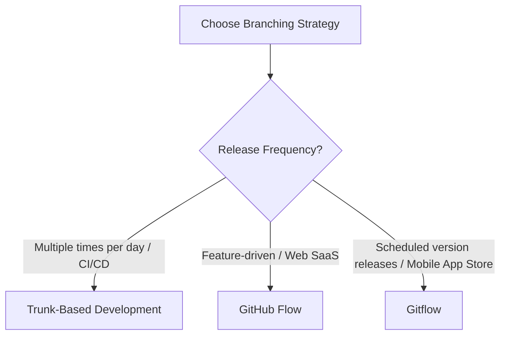

# 06 — Git Workflow & Team Collaboration

## 1. Document Purpose
This document defines version control protocols, branching strategies, commit conventions, code review standards, and release management workflows. It equips engineering teams with clear guidelines to maintain a clean Git history, prevent code conflicts, protect production environments, and collaborate efficiently.

---

## 2. Scope and Applicability
- **Applicability**: All source code repositories across development teams, open-source projects, and enterprise systems using Git.
- **Audience**: Software engineers, tech leads, DevOps/platform engineers, and release managers.
- **Flexibility**: No single branching model fits all organizational shapes. This document outlines **GitHub Flow**, **Gitflow**, and **Trunk-Based Development**, detailing when to adopt each.

---

## 3. Core Principles
- **Atomic Commits**: Each commit must represent a single, logical, and complete change that builds successfully. Never bundle unrelated changes (e.g., refactoring + bug fix) into a single commit.
- **Linear and Legible History**: The commit graph should be straightforward to trace, bisect, and revert when diagnosing regressions.
- **Protected Mainline**: The production branch (`main` / `master`) MUST always remain stable, releasable, and protected against direct pushes.
- **Continuous Peer Review**: Code enters shared environments through peer-reviewed Pull Requests (PRs), ensuring shared code ownership and knowledge transfer.
- **Zero Secrets in Repository History**: Version control is an immutable log; secrets pushed even briefly must be treated as permanently compromised.

---

## 4. Rules and Standards

### 4.1 Commit Standards & Conventional Commits (MUST)
All commit messages MUST adhere to the **Conventional Commits** specification:
```text
<type>(<optional scope>): <description>

[optional body]

[optional footer(s)]
```
- **Allowed Types**:
  - `feat`: A new user-facing feature.
  - `fix`: A bug fix.
  - `refactor`: Code change that neither fixes a bug nor adds a feature.
  - `test`: Adding missing tests or correcting existing tests.
  - `docs`: Documentation changes only.
  - `chore`: Build process, tooling, dependency updates.
  - `perf`: Performance improvement.
  - `style`: Formatting, missing semi-colons (no code logic change).
- **Format Requirements**:
  - Subject line MUST be in the imperative mood ("add", "fix", not "added", "fixes").
  - Subject line SHOULD NOT exceed 72 characters and MUST NOT end with a period.
  - Breaking changes MUST include `!` after the type/scope or `BREAKING CHANGE:` in the footer.

### 4.2 Branching Strategies Selection
Teams MUST select one established strategy based on delivery model:



1. **GitHub Flow** *(Recommended for Web Services & SaaS)*:
   - Branch from `main` $\rightarrow$ Create descriptive feature branch $\rightarrow$ Open PR $\rightarrow$ CI passes + Review $\rightarrow$ Merge to `main` $\rightarrow$ Deploy to production.
2. **Trunk-Based Development** *(Recommended for high-velocity teams)*:
   - Engineers commit directly or via short-lived branches (< 1 day) into `main`. Features guarded by Feature Flags / Toggles.
3. **Gitflow** *(Recommended for Mobile Apps & traditional versioned software)*:
   - Uses dedicated long-lived branches: `main` (production), `develop` (integration), plus ephemeral `feature/*`, `release/*`, `hotfix/*` branches.

### 4.3 Branch Protection Rules (MUST)
For production and staging branches (`main`, `develop`):
- Direct push MUST be disabled (`git push origin main` rejected).
- Force pushing MUST be forbidden (`git push --force`).
- At least 1 approving peer review MUST be required before merge.
- All CI status checks (linting, tests, security scans) MUST pass.

---

## 5. Detailed Explanations: Rebase vs. Merge

| Aspect | `git merge` (Preserve History) | `git rebase` (Linear History) |
| :--- | :--- | :--- |
| **Mechanics** | Creates a new merge commit combining two histories. | Replays your local commits on top of the latest target branch. |
| **History** | Non-linear, captures exact branch branching and joining. | Clean, flat, linear history without cluttered merge bubbles. |
| **Traceability** | Easy to identify the exact group of changes in a PR. | Git bisect is straightforward and clean. |
| **Golden Rule** | Safe on any branch. | **NEVER rebase a public shared branch.** Rebase only local feature branches. |

### Recommended Team Standard:
- Locally update feature branch with latest main: `git fetch origin && git rebase origin/main`.
- Merge PR into main: Use **Squash and Merge** (for small feature branches to condense WIP commits) or **Rebase and Merge** / **Explicit Merge Commit** based on team policy.

---

## 6. Code Review Guidelines

### 6.1 For PR Authors
- **Keep PRs Small (MUST)**: Pull requests SHOULD NOT exceed 400 lines of modified code. Large changes must be sliced into incremental reviewable units.
- **Self-Review First (MUST)**: Review your own diff before requesting review. Verify there are no leftover debug logs (`console.log`, `System.out.println`), unformatted files, or scratch comments.
- **Provide Context**: Include a concise description explaining:
  - *What* changed.
  - *Why* it was needed (link to issue/ticket).
  - *How* it was verified (screenshots, manual test steps).

### 6.2 For Reviewers
- Focus on architectural integrity, edge-case coverage, security vulnerabilities, and logic correctness.
- Automated tools (linters/formatters) must handle style debates, not humans.
- Frame comments constructively. Distinguish between blocking requests (`Must fix: ...`) and non-blocking suggestions (`Nit: ...`, `Consider: ...`).

---

## 7. Handling Accidental Secret Commits (Emergency Protocol)

> [!CAUTION]
> If a real production credential, private key, or API token is committed and pushed to a remote repository, **assume it is compromised immediately**.

1. **Step 1: Revoke Immediately**: Go to the third-party provider (AWS, Stripe, GitHub, Database) and rotate/invalidate the credential immediately. Do not rely on rewriting Git history to preserve an exposed credential.
2. **Step 2: Remove from Git History**:
   - Simply creating a new commit that deletes the file leaves the secret in prior Git history commits.
   - Use `git filter-repo` or BFG Repo-Cleaner to permanently purge the file from all commits:
   ```bash
   # Using BFG Repo-Cleaner
   bfg --delete-files .env
   git reflog expire --expire=now --all && git gc --prune=now --aggressive
   git push --force --all
   ```
3. **Step 3: Notify Security Lead**: File an incident report detailing exposure window.

---

## 8. Practical Git Command Workflows

### 8.1 Daily Feature Workflow (GitHub Flow)
```bash
# 1. Start from updated main
git checkout main
git pull origin main

# 2. Create feature branch with standard naming convention
git checkout -b feat/user-authentication

# 3. Make atomic commits
git add src/auth/
git commit -m "feat(auth): implement JWT token verification middleware"

# 4. Sync with main before PR (rebase to keep linear history)
git fetch origin main
git rebase origin/main

# 5. Push branch to remote
git push -u origin feat/user-authentication
```

### 8.2 Resolving Merge Conflicts Cleanly
```bash
# If rebase encounters conflicts
git fetch origin
git rebase origin/main

# Git stops at the conflicting commit:
# 1. Open IDE and inspect <<<<<<< HEAD vs >>>>>>> markers
# 2. Resolve conflicting lines
# 3. Mark resolved files:
git add <resolved-file>

# 4. Continue rebase (NEVER run git commit here)
git rebase --continue

# (If rebase gets completely derailed, safely abort):
git rebase --abort
```

---

## 9. Technology-Specific Notes
- **Git Hooks via Husky / lint-staged (JavaScript/TypeScript)**:
  - Configure `pre-commit` hook to run linters and formatters only on staged files (`lint-staged`).
  - Configure `commit-msg` hook with `commitlint` to enforce Conventional Commits automatically.
- **Java / Gradle / Maven**:
  - Always verify `.gitignore` includes `target/`, `build/`, `.gradle/`, and IDE-specific metadata (`.idea/`, `*.iml`).
- **Python**:
  - Ensure `.gitignore` ignores `__pycache__/`, `*.pyc`, `.venv/`, and `.pytest_cache/`.
- **Mobile (iOS / Android)**:
  - Ensure keystore files (`*.jks`, `*.keystore`), Google Services JSON files containing sensitive staging identifiers, and build output directories (`Pods/`, `DerivedData/`) are ignored.

---

## 10. Practical Implementation Checklist
- [ ] `.gitignore` is configured before initial code commit.
- [ ] Commit messages follow Conventional Commits format (`type(scope): description`).
- [ ] PR branch protection is active on `main` requiring $\ge 1$ approval and passing CI.
- [ ] PRs average fewer than 400 lines of change.
- [ ] Pre-commit hooks validate formatting and linting locally.
- [ ] Release versions adhere to Semantic Versioning (`vMAJOR.MINOR.PATCH`).
- [ ] No secrets, `.env` files, or production certificates exist in git history.

---

## 11. Common Mistakes and Exceptions
- **"WIP" Commits Pushed to Main**: Commits named "fix bug", "wip", "update", "asdf" clutter history. Squash or reword interactive commits prior to merging.
- **Force Pushing to Shared Branches**: Force pushing (`--force`) to a shared branch overwrites colleagues' work. If you must update a rebased feature branch, use `git push --force-with-lease`.
- **Large Binary Files in Git**: Committing 500MB video assets or database dumps bloats repository clone sizes forever. Use Git LFS (Large File Storage) or external cloud storage.

---

## 12. References to Authoritative Documentation
- Pro Git Book (Scott Chacon and Ben Straub): https://git-scm.com/book/en/v2
- Conventional Commits Specification: https://www.conventionalcommits.org/en/v1.0.0/
- GitHub Flow Guide: https://docs.github.com/en/get-started/using-github/github-flow
- Trunk Based Development: https://trunkbaseddevelopment.com/
- Semantic Versioning 2.0.0 (SemVer): https://semver.org/

---

## 13. Related Documents Within This Library
- [01 — Naming Conventions](../../readme/NAMING_CONVENTION.md)
- [04 — Security & Data Integrity](./04-security-and-data-integrity.md)
- [05 — Testing & Quality Assurance](./05-testing-and-quality-assurance.md)
