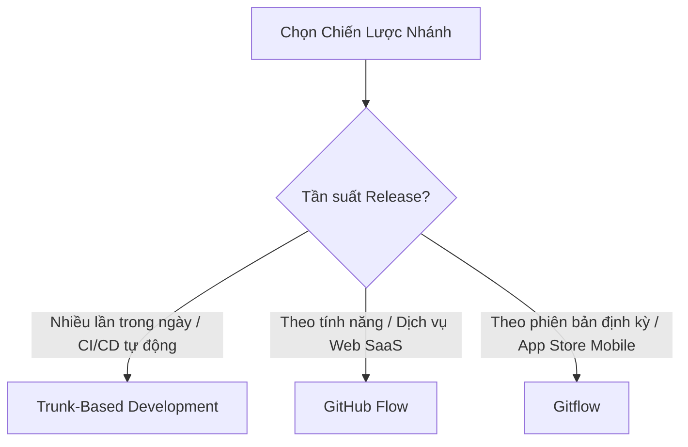

# 06 — Quy Trình Git & Hợp Tác Nhóm (Git Workflow & Team Collaboration)

> **Cấp độ áp dụng**: BẮT BUỘC (MANDATORY)  
> **Trạng thái**: ĐÃ PHÊ DUYỆT (APPROVED) | **Phiên bản**: 2.0.0  
> **Phạm vi**: Toàn bộ kho chứa mã nguồn dự án, pull requests và CI/CD

## 1. Mục Đích Tài Liệu (Document Purpose)
Tài liệu này xác lập các tiêu chuẩn quản lý phiên bản mã nguồn, chiến lược phân nhánh (Branching Strategy), quy chuẩn thông điệp commit (Conventional Commits), tiêu chí đánh giá mã nguồn (Code Review) và quy trình phát hành phần mềm. Tài liệu trang bị cho đội ngũ phát triển các quy tắc rõ ràng nhằm duy trì lịch sử Git trong sạch, giảm thiểu xung đột mã nguồn (Merge Conflict), bảo vệ nhánh môi trường sản phẩm và nâng cao hiệu quả làm việc nhóm.

---

## 2. Phạm Vi Áp Dụng (Scope and Applicability)
- **Hệ thống áp dụng**: Toàn bộ kho chứa mã nguồn (Repository) của các đội ngũ phát triển, dự án mã nguồn mở và hệ thống doanh nghiệp sử dụng Git.
- **Đối tượng hướng đến**: Kỹ sư phần mềm, Tech Lead, kỹ sư DevOps/Platform và quản lý phát hành (Release Manager).
- **Tính linh hoạt**: Không có một mô hình phân nhánh duy nhất phù hợp cho mọi quy mô tổ chức. Tài liệu này hướng dẫn chi tiết 3 mô hình phổ biến nhất: **GitHub Flow**, **Gitflow**, và **Trunk-Based Development**, đồng thời chỉ rõ thời điểm nên áp dụng từng mô hình.

---

## 3. Các Nguyên Tắc Cốt Lõi (Core Principles)
- **Commit nguyên tử (Atomic Commits)**: Mỗi commit phải đại diện cho một thay đổi logic duy nhất, hoàn chỉnh và build thành công. Tuyệt đối không gom các thay đổi không liên quan (ví dụ: vừa refactor vừa sửa lỗi) vào chung một commit.
- **Lịch sử tuyến tính và rõ ràng (Linear & Legible History)**: Đồ thị commit phải dễ theo dõi, dễ dùng lệnh `git bisect` để dò tìm lỗi và dễ revert khi có sự cố.
- **Bảo vệ nhánh chính (Protected Mainline)**: Nhánh sản phẩm (`main` / `master`) BẮT BUỘC phải luôn ở trạng thái ổn định, sẵn sàng release và được bảo vệ nghiêm ngặt chống push trực tiếp.
- **Bình duyệt mã nguồn liên tục (Continuous Peer Review)**: Mã nguồn chỉ được đưa vào nhánh chung thông qua Pull Request (PR) có sự bình duyệt của đồng nghiệp, đảm bảo kiến thức dự án được chia sẻ đều trong đội ngũ.
- **Tuyệt đối không lưu khóa bí mật trong lịch sử Git**: Git là cuốn sổ nhật ký bất biến; bất kỳ secret nào vô tình bị đẩy lên đều phải bị coi là đã lộ lọt hoàn toàn.

---

## 4. Các Quy Tắc Và Tiêu Chuẩn (Rules and Standards)

### 4.1 Tiêu Chuẩn Commit: Conventional Commits (BẮT BUỘC - MUST)
Toàn bộ thông điệp commit BẮT BUỘC phải tuân thủ chuẩn **Conventional Commits**:
```text
<type>(<phạm vi tùy chọn>): <mô tả ngắn>

[phần nội dung chi tiết tùy chọn]

[phần chân footer tùy chọn]
```
- **Các loại commit (Types) được phép**:
  - `feat`: Tính năng mới cho người dùng.
  - `fix`: Sửa lỗi (bug fix).
  - `refactor`: Tái cấu trúc code (không sửa lỗi cũng không thêm tính năng mới).
  - `test`: Thêm bài test mới hoặc sửa bài test có sẵn.
  - `docs`: Chỉ thay đổi tài liệu.
  - `chore`: Cập nhật cấu hình build, công cụ hỗ trợ hoặc thư viện phụ thuộc.
  - `perf`: Cải thiện hiệu năng xử lý.
  - `style`: Định dạng code, dấu chấm phẩy (không đổi logic code).
- **Yêu cầu định dạng**:
  - Tiêu đề dùng thể mệnh lệnh ("add", "fix", không dùng "added", "fixes").
  - Tiêu đề KHÔNG NÊN vượt quá 72 ký tự và KHÔNG kết thúc bằng dấu chấm.
  - Thay đổi gây phá vỡ tính tương thích (Breaking Change) BẮT BUỘC phải có dấu `!` sau type/scope hoặc có dòng `BREAKING CHANGE:` ở footer.

### 4.2 Lựa Chọn Chiến Lược Phân Nhánh (Branching Strategy)
Đội ngũ BẮT BUỘC phải thống nhất một chiến lược phù hợp với mô hình phát hành:



1. **GitHub Flow** *(Khuyến nghị cho Dịch vụ Web & SaaS)*:
   - Tạo nhánh tính năng từ `main` $\rightarrow$ Mở PR $\rightarrow$ CI kiểm tra đạt + Đồng nghiệp duyệt $\rightarrow$ Merge vào `main` $\rightarrow$ Tự động triển khai Production.
2. **Trunk-Based Development** *(Khuyến nghị cho đội ngũ phát triển tốc độ cao)*:
   - Các kỹ sư commit trực tiếp hoặc qua các nhánh cực ngắn (< 1 ngày) vào nhánh chính. Tính năng mới được ẩn sau cơ chế cờ tính năng (Feature Flags).
3. **Gitflow** *(Khuyến nghị cho Ứng dụng Mobile và phần mềm đóng gói phiên bản)*:
   - Sử dụng hai nhánh chính dài hạn: `main` (sản phẩm) và `develop` (tích hợp), cùng các nhánh tạm thời: `feature/*`, `release/*`, `hotfix/*`.

### 4.3 Quy Tắc Bảo Vệ Nhánh - Branch Protection (BẮT BUỘC - MUST)
Trên các nhánh nhạy cảm (`main`, `develop`):
- Tắt quyền push trực tiếp (`git push origin main` bị từ chối).
- Cấm tuyệt đối force push (`git push --force`).
- Yêu cầu ít nhất 1 thành viên phê duyệt (Approve) trước khi merge PR.
- Toàn bộ các bước kiểm tra tự động trên CI (lint, test, quét bảo mật) phải pass 100%.

---

## 5. Giải Thích Chi Tiết: So Sánh Rebase vs. Merge

| Tiêu chí | `git merge` (Giữ nguyên lịch sử) | `git rebase` (Lịch sử tuyến tính) |
| :--- | :--- | :--- |
| **Cơ chế hoạt động** | Tạo một commit merge mới kết nối hai dòng lịch sử lại với nhau. | Tua lại và áp dụng các commit của bạn lên đầu nhánh đích mới nhất. |
| **Đồ thị lịch sử** | Phi tuyến tính, ghi nhận chính xác thời điểm tách và gộp nhánh. | Tuyến tính, phẳng, sạch sẽ, không có các "bong bóng" merge rối rắm. |
| **Dò tìm lỗi** | Dễ dàng thấy toàn bộ cụm thay đổi trong một PR. | Lệnh `git bisect` hoạt động mượt mà và tìm ra lỗi cực nhanh. |
| **Nguyên tắc vàng** | An toàn trên mọi loại nhánh. | **TUYỆT ĐỐI KHÔNG rebase trên nhánh công khai dùng chung.** Chỉ rebase nhánh local của bạn. |

### Chuẩn quy trình khuyến nghị:
- Đồng bộ nhánh cá nhân với `main` mới nhất: `git fetch origin && git rebase origin/main`.
- Merge PR vào `main`: Dùng cơ chế **Squash and Merge** (để gộp các commit vụn vặt khi code tính năng thành 1 commit hoàn chỉnh) hoặc **Rebase and Merge** tùy quy định dự án.

---

## 6. Tiêu Chuẩn Bình Duyệt Mã Nguồn (Code Review)

### 6.1 Dành Cho Tác Giả Pull Request (PR Author)
- **Giữ PR nhỏ gọn (BẮT BUỘC - MUST)**: PR KHÔNG NÊN vượt quá 400 dòng code thay đổi. PR lớn phải được chia nhỏ thành các đợt merge lũy tiến.
- **Tự review trước khi giao việc (BẮT BUỘC - MUST)**: Luôn xem lại diff của chính mình trước khi bấm gửi review. Xóa bỏ toàn bộ log debug thừa (`console.log`, `System.out.println`), định dạng lại code và dọn dẹp các ghi chú nháp.
- **Cung cấp ngữ cảnh rõ ràng**: Phần mô tả PR phải nêu rõ:
  - *Cái gì* đã được thay đổi.
  - *Tại sao* lại cần thay đổi (link tới ticket Jira/Trello/GitHub Issue).
  - *Đã kiểm tra bằng cách nào* (ảnh chụp màn hình, các bước test thủ công).

### 6.2 Dành Cho Người Đánh Giá (Reviewer)
- Tập trung vào tính toàn vẹn kiến trúc, xử lý trường hợp biên, lỗ hổng bảo mật và tính đúng đắn của logic.
- Việc kiểm tra định dạng, style code hãy để linter tự động làm, không tốn thời gian tranh cãi trên PR.
- Góp ý mang tính xây dựng. Phân định rõ ràng giữa yêu cầu bắt buộc sửa (`Must fix: ...`) và gợi ý mang tính tham khảo (`Nit: ...`, `Gợi ý: ...`).

---

## 7. Quy Trình Khẩn Cấp Xử Lý Khi Lộ Secret Lên Git

> [!CAUTION]
> Nếu bạn vô tình commit và push mật khẩu database, khóa API thật hoặc private key lên repository, **hãy coi như thông tin đó đã bị kẻ xấu chiếm đoạt ngay lập tức**.

1. **Bước 1: Thu hồi & Đổi khóa ngay lập tức**: Truy cập vào dịch vụ cấp khóa (AWS, Stripe, GitHub, cơ sở dữ liệu) và thu hồi (Revoke/Rotate) khóa bí mật đó ngay tức khắc. Việc xóa commit trên Git không bảo vệ được secret nếu nó đã lọt vào tay bot quét tự động.
2. **Bước 2: Thanh trừng lịch sử Git**:
   - Tạo commit mới để xóa file không giải quyết được vấn đề vì file vẫn nằm trong các commit cũ trước đó.
   - Sử dụng công cụ BFG Repo-Cleaner hoặc `git filter-repo` để xóa vĩnh viễn file nhạy cảm khỏi toàn bộ lịch sử:
   ```bash
   # Dùng BFG Repo-Cleaner để xóa sạch file .env
   bfg --delete-files .env
   git reflog expire --expire=now --all && git gc --prune=now --aggressive
   git push --force --all
   ```
3. **Bước 3: Báo cáo Tech Lead**: Lập biên bản sự cố để ghi nhận thời gian lộ lọt và các biện pháp đã xử lý.

---

## 8. Các Câu Lệnh Git Thực Chiến Chuẩn Hóa

### 8.1 Quy Trình Làm Việc Hàng Ngày (GitHub Flow)
```bash
# 1. Bắt đầu từ nhánh main mới nhất
git checkout main
git pull origin main

# 2. Tạo nhánh tính năng theo quy ước đặt tên
git checkout -b feat/user-authentication

# 3. Tạo các commit nguyên tử
git add src/auth/
git commit -m "feat(auth): thêm middleware xác thực JWT token"

# 4. Đồng bộ nhánh main trước khi tạo PR (rebase để giữ lịch sử tuyến tính)
git fetch origin main
git rebase origin/main

# 5. Push nhánh lên server
git push -u origin feat/user-authentication
```

### 8.2 Xử Lý Xung Đột (Merge Conflicts) Một Cách An Toàn
```bash
# Nếu quá trình rebase gặp conflict
git fetch origin
git rebase origin/main

# Git sẽ tạm dừng tại commit bị xung đột:
# 1. Mở IDE và xem các đoạn bị đánh dấu <<<<<<< HEAD và >>>>>>>
# 2. Chỉnh sửa và giữ lại code chính xác
# 3. Đánh dấu file đã giải quyết xong xung đột:
git add <file-da-fix>

# 4. Tiếp tục quá trình rebase (TUYỆT ĐỐI KHÔNG dùng git commit ở đây)
git rebase --continue

# (Nếu quá trình rebase bị rối loạn nghiêm trọng, có thể hủy bỏ an toàn về trạng thái ban đầu):
git rebase --abort
```

---

## 9. Lưu Ý Theo Từng Công Nghệ Cụ Thể (Technology Notes)
- **Git Hooks với Husky & lint-staged (JavaScript/TypeScript)**:
  - Cài đặt hook `pre-commit` để tự động chạy linter và formatter chỉ trên các file đang được staged (`lint-staged`).
  - Cài đặt hook `commit-msg` với `commitlint` để tự động kiểm tra cú pháp Conventional Commits.
- **Java / Gradle / Maven**:
  - Luôn kiểm tra cấu hình `.gitignore` để loại bỏ thư mục build (`target/`, `build/`, `.gradle/`) và metadata của IDE (`.idea/`, `*.iml`).
- **Python**:
  - Đảm bảo `.gitignore` đã chặn các thư mục cache (`__pycache__/`, `*.pyc`, `.venv/`, `.pytest_cache/`).
- **Mobile (iOS / Android)**:
  - Đảm bảo các file Keystore ký app (`*.jks`, `*.keystore`), file cấu hình Google Services nhạy cảm và thư mục build (`Pods/`, `DerivedData/`) không bị đẩy lên Git.

---

## 10. Bảng Tự Kiểm Tra Thực Tế (Implementation Checklist)
- [ ] File `.gitignore` được cấu hình đầy đủ trước commit đầu tiên của dự án.
- [ ] Thông điệp commit tuân thủ định dạng Conventional Commits (`type(scope): description`).
- [ ] Tính năng Branch Protection đã được bật trên nhánh `main` (yêu cầu $\ge 1$ approve và pass CI).
- [ ] PR giữ kích thước nhỏ gọn dưới 400 dòng thay đổi.
- [ ] Git hook tự động kiểm tra format và lint trước khi commit.
- [ ] Các bản release được gắn thẻ (Tag) tuân thủ Semantic Versioning (`vMAJOR.MINOR.PATCH`).
- [ ] Không có file `.env`, mật khẩu hay chứng chỉ nào xuất hiện trong lịch sử Git.

---

## 11. Sai Lầm Phổ Biến Và Ngoại Lệ (Mistakes & Exceptions)
- **Các commit "WIP" cẩu thả trên nhánh chung**: Commit có tên "fix bug", "wip", "update", "chạy thử" làm rác lịch sử dự án. Hãy gộp (squash) chúng lại trước khi merge.
- **Force push đè lên nhánh chung**: Lệnh `git push --force` lên nhánh có nhiều người đang làm việc chung sẽ xóa sạch commit của đồng nghiệp. Nếu bắt buộc phải push sau rebase, hãy dùng `git push --force-with-lease`.
- **Lưu file nhị phân dung lượng lớn vào Git**: Commit video 500MB hoặc file backup database vào Git sẽ làm phình to dung lượng clone mãi mãi. Hãy dùng Git LFS hoặc lưu trên Cloud Object Storage.

---

## 12. Tài Liệu Tham Khảo Uy Tín (References)
- Sách Pro Git (Scott Chacon & Ben Straub): https://git-scm.com/book/en/v2
- Đặc tả Conventional Commits: https://www.conventionalcommits.org/en/v1.0.0/
- Hướng dẫn GitHub Flow: https://docs.github.com/en/get-started/using-github/github-flow
- Chiến lược Trunk-Based Development: https://trunkbaseddevelopment.com/
- Tiêu chuẩn phiên bản Semantic Versioning (SemVer): https://semver.org/

---

## 13. Các Tài Liệu Liên Quan Trong Bộ Tiêu Chuẩn

| Số thứ tự | Tên tài liệu chuẩn hóa | Trọng tâm kỹ thuật |
| :---: | :--- | :--- |
| **Portal** | [Cổng Tiêu Chuẩn Kỹ Thuật Dự Án](./README.md) | Khung kiến trúc tổng thể, quy trình RFC & ma trận đọc hiểu |
| **01** | [Quy Chuẩn Đặt Tên & Cú Pháp Mã Nguồn](./01-naming-conventions-and-syntax-standards.md) | Intention-revealing, Case styles, Bảng tra cứu đa ngôn ngữ |
| **02** | [Nguyên Lý Clean Code & Thiết Kế Phần Mềm](./02-clean-code-and-design-principles.md) | SOLID, KISS, DRY, Guard clauses, Quản lý độ phức tạp |
| **03** | [Kiến Trúc & Mẫu Thiết Kế Phần Mềm](./03-architecture-and-design-patterns.md) | Phân tầng Layered, Hexagonal, Dependency Injection, ADR |
| **04** | [Bảo Mật & Toàn Vẹn Dữ Liệu](./04-security-and-data-integrity.md) | OWASP Top 10, Zero Trust, RBAC/BOLA, Mã hóa & Secrets |
| **05** | [Kiểm Thử & Đảm Bảo Chất Lượng](./05-testing-and-quality-assurance.md) | Test Pyramid, AAA Pattern, Zero-flakiness, Quality Gates |
| **06** | **Quy Trình Git & Hợp Tác Nhóm** *(Tài liệu này)* | Conventional Commits, Phân nhánh, Code Review Checklist |
| **07** | [Thiết Kế API & Cơ Sở Dữ Liệu](./07-api-design-and-database-principles.md) | RESTful contracts, Idempotency, Indexing, Transactions |
| **08** | [Hiệu Năng, Khả Năng Tiếp Cận & Vận Hành](./08-performance-accessibility-and-operations.md) | Core Web Vitals, a11y WCAG 2.2 AA, SRE & Observability |
