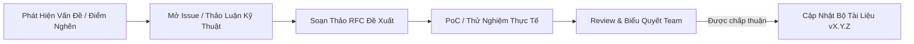

# 🏛️ Cổng Tiêu Chuẩn Kỹ Thuật & Quản Trị Kiến Trúc (Engineering Standards Portal)

> **Dự án**: Fullstack Project Template (React 19 + Express 5 + Spring Boot 3 + PostgreSQL/MySQL)  
> **Quản trị bởi**: Chu Thế Văn (VanCt) & Đội ngũ Kỹ nghệ Phần mềm  
> **Trạng thái**: ACTIVE / LIVING DOCUMENTATION | **Phiên bản**: `2.0.0`

---

## 🧭 1. Tầm Nhìn & Triết Lý Kỹ Nghệ (Senior Engineering Philosophy)

Bộ tiêu chuẩn kỹ thuật này không được tạo ra để trói buộc sự sáng tạo, mà đóng vai trò là **kim chỉ nam bảo vệ sức khỏe dài hạn của hệ thống**. Một codebase chuyên nghiệp cấp độ doanh nghiệp (Production-Grade) đòi hỏi sự nhất quán tuyệt đối về tư duy thiết kế, ranh giới module rõ ràng và tính kỷ luật trong từng dòng code.

### 4 Trụ Cột Tư Duy Cốt Lõi:
1. **Dễ đọc quan trọng hơn ngắn gọn (Readability Over Cleverness)**: Code được đọc nhiều gấp ít nhất 10 lần so với lúc được viết. Luôn tối ưu cho người bảo trì tương lai.
2. **Thực dụng trên hết, tránh giáo điều (Pragmatism Over Dogmatism)**: Không áp dụng Clean Architecture hay Microservices một cách mù quáng. Bắt đầu từ kiến trúc đơn giản nhất có thể vận hành tốt (Modular Monolith) và chỉ trừu tượng hóa khi sự biến thiên nghiệp vụ là có thật.
3. **Phòng thủ theo chiều sâu (Defense-in-Depth & Zero Trust)**: Mọi dữ liệu đi qua ranh giới mạng đều là không an toàn. Kiểm tra bảo mật, phân quyền, và xác thực hợp đồng dữ liệu ở từng tầng độc lập.
4. **Hệ thống có thể quan sát và tự phục hồi (Observable & Resilient)**: Code chỉ thực sự hoàn thành (Definition of Done) khi có thể giám sát được (Metrics, Logs, Tracing), có bài test tự động bảo vệ và có cơ chế phục hồi khi sự cố xảy ra.

---

## 🚦 2. Quy Chuẩn Mức Độ Tuân Thủ (RFC 2119 Standard)

Mọi quy định trong bộ tài liệu đều sử dụng các từ khóa chuẩn hóa quốc tế theo **RFC 2119**:
- **BẮT BUỘC (MUST / SHALL / REQUIRED)**: Ràng buộc tuyệt đối. Bất kỳ vi phạm nào đều bị hệ thống linter chặn hoặc bị Reviewer từ chối (Request Changes) trên Pull Request.
- **TUYỆT ĐỐI KHÔNG (MUST NOT / SHALL NOT)**: Hành vi bị cấm hoàn toàn trong codebase (ví dụ: hardcode secret, catch rỗng ngoại lệ, lồng quá 3 cấp thụt lề).
- **NÊN (SHOULD / RECOMMENDED)**: Tiêu chuẩn thực hành tốt nhất. Được phép làm khác chỉ khi có lý do kỹ thuật chính đáng và được Tech Lead đồng thuận.
- **KHÔNG NÊN (SHOULD NOT / NOT RECOMMENDED)**: Tiềm ẩn nguy cơ kỹ thuật hoặc nợ kỹ thuật (Technical Debt), cần hạn chế tối đa.
- **TÙY CHỌN (MAY / OPTIONAL)**: Lựa chọn linh hoạt tùy thuộc vào ngữ cảnh và quy mô của module.

---

## 📚 3. Ma Trận Bộ Tiêu Chuẩn Kỹ Thuật (Standards Navigation Matrix)

Bộ tài liệu gồm 8 cẩm nang chuyên sâu, được đánh số khoa học và liên kết hữu cơ với nhau:

| Thứ tự | Tài liệu tiêu chuẩn | Trọng tâm kỹ thuật cốt lõi | Công nghệ liên đới | Cấp độ |
| :---: | :--- | :--- | :--- | :---: |
| **01** | [**Quy Chuẩn Đặt Tên & Cú Pháp**](./01-naming-conventions-and-syntax-standards.md) | Intention-revealing, case styles, danh từ/động từ, bảng tra cứu đa ngôn ngữ, triệt tiêu disinformation. | Fullstack, SQL, Git, Shell | `MUST` |
| **02** | [**Nguyên Lý Clean Code & Thiết Kế**](./02-clean-code-and-design-principles.md) | SOLID, KISS, DRY, YAGNI, Guard Clauses, xử lý ngoại lệ chuẩn, triệt tiêu code smell & dead code. | Frontend & Backend Logic | `MUST` |
| **03** | [**Kiến Trúc & Mẫu Thiết Kế**](./03-architecture-and-design-patterns.md) | Phân tầng Controller-Service-Repository, ranh giới module, Dependency Injection, ADR template. | Express, Spring, React | `MUST` |
| **04** | [**Bảo Mật & Toàn Vẹn Dữ Liệu**](./04-security-and-data-integrity.md) | OWASP Top 10, phòng chống SQLi/XSS/CSRF, BOLA/IDOR, băm Argon2/BCrypt, quản lý Secrets, Zero Trust. | API, DB, JWT, Auth | `MUST` |
| **05** | [**Kiểm Thử & Đảm Bảo Chất Lượng**](./05-testing-and-quality-assurance.md) | Test Pyramid (70-20-10), mẫu Arrange-Act-Assert, triệt tiêu Flaky Test, Mocking có kỷ luật, CI Gates. | JUnit 5, Jest/Vitest, Mockito | `MUST` |
| **06** | [**Quy Trình Git & Hợp Tác Nhóm**](./06-git-workflow-and-team-collaboration.md) | Conventional Commits, chiến lược GitHub Flow vs Trunk-Based, Atomic Commits, Review Etiquette. | Git, GitHub, GitLab | `MUST` |
| **07** | [**Thiết Kế API & Cơ Sở Dữ Liệu**](./07-api-design-and-database-principles.md) | Hợp đồng RESTful URI, Standard Envelope, Idempotency, mã lỗi HTTP, chuẩn hóa DB, Indexing, ACID. | Express, Spring, PostgreSQL, MySQL | `MUST` |
| **08** | [**Hiệu Năng, Tiếp Cận & Vận Hành**](./08-performance-accessibility-and-operations.md) | Core Web Vitals (LCP/INP/CLS), WCAG 2.2 AA a11y, Docker multi-stage, Health checks, Observability. | React, Docker, Nginx, DevOps | `MUST` |

---

## 🎯 4. Lộ Trình Đọc Hiểu Theo Vai Trò (Role-Based Reading Paths)

### 🟢 Dành cho Kỹ Sư Mới Gia Nhập Dự Án (Onboarding Path)
Mục tiêu: Đạt năng suất code trong 48 giờ đầu tiên mà không vi phạm quy chuẩn dự án.
1. Đọc kỹ [`01 — Quy Chuẩn Đặt Tên & Cú Pháp`](./01-naming-conventions-and-syntax-standards.md) để đồng nhất ngôn ngữ giao tiếp.
2. Nắm vững [`06 — Quy Trình Git & Hợp Tác Nhóm`](./06-git-workflow-and-team-collaboration.md) để biết cách đặt tên branch và viết commit message chuẩn.
3. Đọc [`02 — Nguyên Lý Clean Code & Thiết Kế Phần Mềm`](./02-clean-code-and-design-principles.md) trước khi bắt tay viết dòng code đầu tiên.

### 🔵 Dành cho Kỹ Sư Phát Triển Tính Năng (Feature Developer Path)
Mục tiêu: Xây dựng tính năng ổn định, đúng kiến trúc và sẵn sàng kiểm thử.
1. Tham chiếu [`03 — Kiến Trúc & Mẫu Thiết Kế Phần Mềm`](./03-architecture-and-design-patterns.md) để đặt đúng file vào đúng tầng (`controller`, `service`, `repository`, `dto`).
2. Tuân thủ [`07 — Thiết Kế API & Cơ Sở Dữ Liệu`](./07-api-design-and-database-principles.md) khi tạo endpoint mới và thiết kế lược đồ bảng.
3. Viết test theo tiêu chuẩn [`05 — Kiểm Thử & Đảm Bảo Chất Lượng Phần Mềm`](./05-testing-and-quality-assurance.md).

### 🔴 Dành cho Tech Lead & Code Reviewer (Reviewer & Governance Path)
Mục tiêu: Giữ vững cổng chất lượng, bảo mật và kiến trúc hệ thống.
1. Kiểm tra lỗ hổng bảo mật theo checklist của [`04 — Bảo Mật & Toàn Vẹn Dữ Liệu`](./04-security-and-data-integrity.md).
2. Đánh giá tác động hiệu năng và chuẩn vận hành theo [`08 — Hiệu Năng, Khả Năng Tiếp Cận & Vận Hành`](./08-performance-accessibility-and-operations.md).
3. Đảm bảo mọi quyết định thay đổi cấu trúc lớn đều có hồ sơ **ADR (Architecture Decision Record)** đi kèm.

---

## 🛡️ 5. Cổng Chất Lượng Định Nghĩa Hoàn Thành (Definition of Done - DoD)

Một Pull Request (PR) chỉ được phép merge vào nhánh `main` khi vượt qua trọn vẹn 7 tiêu chí sau:

- [ ] **1. Compile & Build**: Dự án biên dịch và build sạch sẽ trên cả 3 dịch vụ (`react-frontend`, `express-backend`, `spring-backend`) mà không có warning nghiêm trọng.
- [ ] **2. Lint & Format**: Không vi phạm quy tắc linter (ESLint, Prettier, Checkstyle/Spotless).
- [ ] **3. Automated Tests**: 100% Unit Test và Integration Test vượt qua thành công trên CI pipeline.
- [ ] **4. Naming & Clean Code**: Tuân thủ quy chuẩn đặt tên tiếng Anh, không có dead code, không có magic numbers, hàm không lồng quá 3 cấp.
- [ ] **5. Security Check**: Không hardcode secret/token, mọi endpoint đều có xác thực/phân quyền, câu lệnh database được tham số hóa 100%.
- [ ] **6. Contract Uniformity**: API phản hồi đúng chuẩn bao bọc JSON `{ success, message, data, timestamp }`.
- [ ] **7. Peer Review**: Nhận được tối thiểu **1 chấp thuận (Approval)** từ đồng nghiệp hoặc Tech Lead.

---

## 📝 6. Quy Trình Đề Xuất & Cập Nhật Tiêu Chuẩn (RFC Process)

Tiêu chuẩn kỹ thuật là **tài liệu sống**. Khi công nghệ hoặc yêu cầu kinh doanh thay đổi, bất kỳ kỹ sư nào cũng có quyền đề xuất cải tiến:

1. **Mở thảo luận**: Tạo Issue hoặc trao đổi kỹ thuật với nhóm, chỉ ra điểm nghẽn hoặc bất cập của quy chuẩn hiện hành.
2. **Soạn RFC (Request for Comments)**: Nêu rõ: *Vấn đề là gì? Phương án đề xuất là gì? Đánh đổi (Trade-offs) và chi phí chuyển đổi (Migration Cost) ra sao?*
3. **Thực nghiệm PoC (Proof of Concept)**: Triển khai thử nghiệm trên một module mẫu để kiểm chứng tính khả thi.
4. **Phê duyệt & Hợp nhất**: Cập nhật trực tiếp vào file markdown tương ứng trong thư mục `readme/` và tăng số phiên bản tài liệu.
